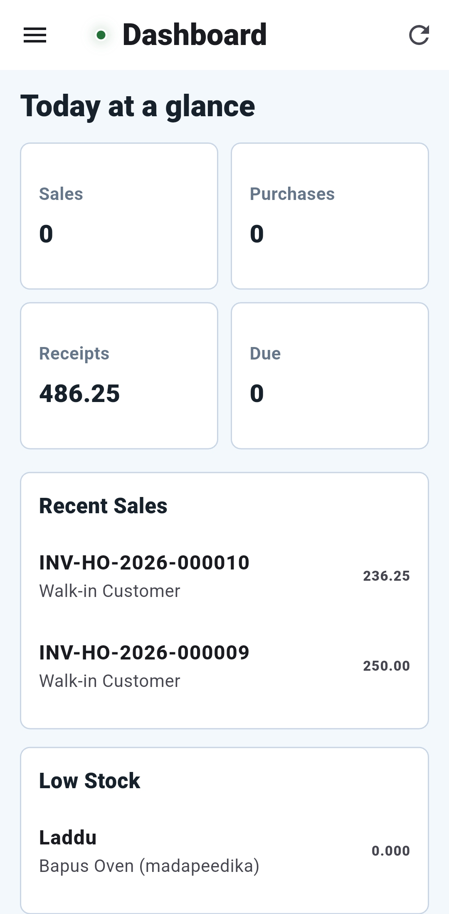
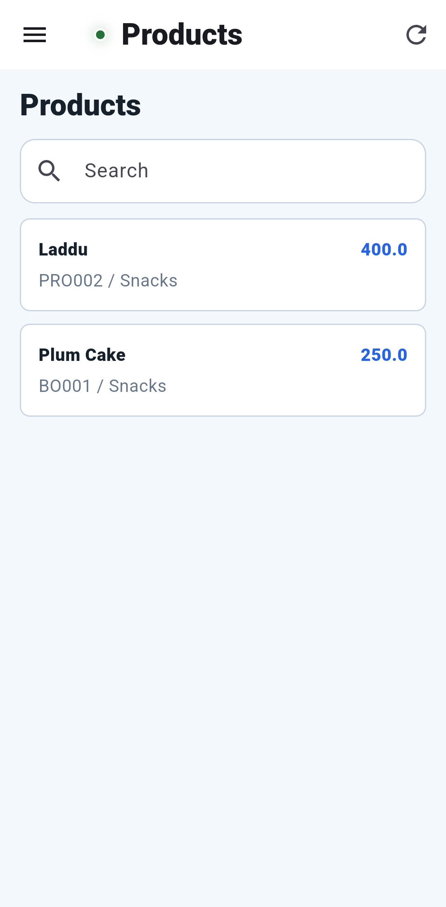
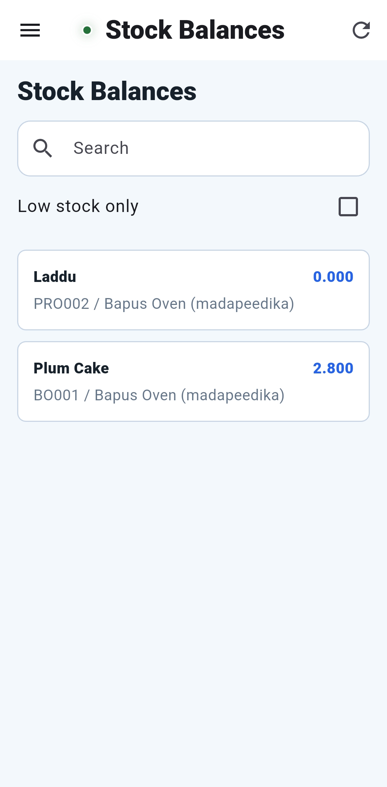

# Retail Billing Mobile

Android-first Flutter client for the Retail Billing system. It uses the same
Django REST APIs and business data as the React web application.

```text
retail-billing/
  backend/             Django REST backend
  frontend/            React web application
  mobile-app-flutter/  Flutter Android application
```

## Screen Preview

<table>
  <tr>
    <td align="center"><strong>Dashboard</strong></td>
    <td align="center"><strong>Products</strong></td>
    <td align="center"><strong>Stock Balances</strong></td>
  </tr>
  <tr>
    <td></td>
    <td></td>
    <td></td>
  </tr>
</table>

The green status dot means the configured backend is reachable. It appears on
the login screen and in the app bar after login.

## Implemented Screens

### Authentication

- Login
- Signup
- Forgot password and reset password

### Main Application

- Dashboard with totals, recent sales, and low-stock data
- POS with product lookup, customer selection, cart editing, discounts, tax,
  round-off, held bills, split payments, checkout, receipt preview, sharing,
  WhatsApp, and printing
- My Account
- Sales History with invoice filters, totals, item detail, draft cancellation,
  deletion, and completed-sale receipt printing
- Customers with create, edit, delete, search, status, tax, and credit fields
- Suppliers with create, edit, delete, search, location, tax, credit, and
  payment-term fields
- Users
- Stores with create, edit, delete, filtering, manager, location, trading
  hours, receipt settings, and stock-policy fields

### Catalog and Stock

- Products with create, edit, delete, search, stock filtering, master-data
  selection, pricing, stock limits, and approval-based stock updates
- Stock Balances with search, low-stock filtering, stock-in/stock-out adjustment
  requests, and pending request approval or rejection
- Inventory Ledger / Stock Transactions

### Settings

- Settings Home
- Roles
- Permissions
- Role Permissions
- User Roles

## Architecture

The app is intentionally small and uses Flutter SDK components without a
third-party state-management framework.

```text
Flutter Screen
    |
    v
Domain Service
    |
    v
ApiClient --------------> Django REST API
    |                           |
    | Bearer access token       v
    +------ SessionStore   Shared database with web app

MobileActions
    |
    v
Android MethodChannel -> URL opening, sharing, local preferences
```

### Application Layers

| Layer | Files | Responsibility |
| --- | --- | --- |
| Composition | `lib/main.dart` | Loads configuration, creates services, defines named routes, and starts the app. |
| Screens | `lib/screens/` | Mobile UI and screen-level workflow state. |
| Shared UI | `lib/widgets/`, `lib/theme.dart` | App shell, scrollable sidebar, authentication layout, status indicator, cards, and theme colors. |
| Services | `lib/*_service.dart` | Backend operations grouped by authentication, dashboard, billing, people, catalog, and RBAC. |
| HTTP | `lib/api_client.dart` | JSON requests, bearer authentication, timeouts, response decoding, and readable API errors. |
| Session | `lib/session_store.dart` | Current access token, refresh token, user, organization, and store context. |
| Configuration | `lib/env.dart`, `.env` | Loads `API_BASE_URL` from the bundled environment asset. |
| Android bridge | `lib/mobile_actions.dart`, `MainActivity.java` | Opens receipt URLs, shares invoice text, and stores POS draft data in Android preferences. |

### Request Flow

1. `main.dart` loads `.env` before creating the application.
2. Login calls `POST /auth/login/` through `AuthService` and `ApiClient`.
3. Access and refresh tokens plus organization/store context are stored in
   `SessionStore`.
4. Authorized requests include `Authorization: Bearer <access-token>`.
5. Screens call a domain service and render the decoded backend response.
6. Backend validation errors are converted into short field-level messages.

### Stock Adjustment Flow

1. Open **Stock Balances** and tap the app-bar `+`, or tap an existing stock
   row to preselect its product and store.
2. Choose stock in or stock out and enter quantity, unit cost, reason,
   reference number, and remarks. A reference number is required for stock out.
3. The app submits the request to `POST /inventory/adjustment-requests/`.
4. The request appears under **Pending approvals**. Approving it calls the same
   backend approval action used by the web app and then refreshes the balance.
5. Rejecting a request records optional review notes without changing stock.

Stock is changed only after approval. This preserves the backend inventory
ledger and matches the React application's stock-control workflow.

### Navigation

```text
Login
  |-- Signup
  |-- Forgot Password
  `-- Dashboard
       |-- POS
       |-- Sales History
       |-- My Account
       |-- Customers / Suppliers / Users / Stores
       |-- Products / Stock Balances / Inventory Ledger
       `-- Settings / Roles / Permissions / User Roles
```

The application drawer keeps its header and Logout action visible while the
navigation list scrolls on smaller phones.

## Project Structure

```text
mobile-app-flutter/
  .env.example
  .gitignore
  pubspec.yaml
  pubspec.lock
  README.md
  android/
    app/
      src/main/
        AndroidManifest.xml
        java/com/retailbilling/mobile/MainActivity.java
        res/mipmap-*/ic_launcher.png
    build.gradle.kts
    gradle.properties
    settings.gradle.kts
  docs/
    screenshots/
  lib/
    main.dart
    env.dart
    api_client.dart
    session_store.dart
    mobile_actions.dart
    data_utils.dart
    theme.dart
    auth_service.dart
    dashboard_service.dart
    billing_service.dart
    people_service.dart
    catalog_service.dart
    rbac_service.dart
    screens/
      login_screen.dart
      signup_screen.dart
      forgot_password_screen.dart
      dashboard_screen.dart
      pos_screen.dart
      sales_screen.dart
      account_screen.dart
      people_screen.dart
      stores_screen.dart
      products_screen.dart
      catalog_screens.dart
      settings_screen.dart
      rbac_screens.dart
    widgets/
      auth_shell.dart
      app_shell.dart
      backend_status_dot.dart
  scripts/
    live_login_check.dart
    verify_phase1.mjs
    verify_phase2.mjs
    verify_phase3.mjs
    verify_pos.mjs
    verify_forms.mjs
    verify_commerce.mjs
```

## API Groups

| Area | Endpoints |
| --- | --- |
| Authentication | `/auth/login/`, `/auth/register/`, `/auth/forgot-password/`, `/auth/reset-password/`, `/auth/me/`, `/auth/profile/` |
| Dashboard | `/reports/dashboard/` |
| POS | `/stores/`, `/billing/products/lookup/`, `/v1/products/`, `/v1/masters/payment-methods/`, `/billing/checkout/`, `/billing/invoices/{invoice}/` |
| Sales History | `/sales/`, `/sales/{id}/`, `/sales/{id}/cancel/`, `/billing/invoices/{invoice}/` |
| Parties | `/customer/customers/`, `/v1/supplier/`, `/users/` |
| Stores | `/stores/`, `/stores/{uuid}/`, `/organizations/` |
| Catalog | `/v1/products/`, `/v1/products/{id}/`, `/v1/masters/categories/`, `/v1/masters/brands/`, `/v1/masters/units/`, `/v1/masters/taxes/` |
| Stock | `/v1/stocks/`, `/inventory/transactions/`, `/inventory/adjustment-requests/`, `/inventory/adjustment-requests/{id}/approve/`, `/inventory/adjustment-requests/{id}/reject/` |
| RBAC | `/rbac/roles/`, `/rbac/permission-groups/`, `/rbac/permissions/`, `/rbac/user-roles/` |

Create forms intentionally use the same field choices and payload keys as the
web application and backend serializers.

## Prerequisites

- Windows 10 or Windows 11
- Flutter SDK installed at `C:\flutter`
- Android SDK, Platform Tools, and Build Tools
- A compatible Java installation; this project currently uses Android
  Studio's bundled JBR
- Node.js for the verification scripts
- Python and the backend requirements for Django

Check the local toolchain:

```powershell
C:\flutter\bin\flutter.bat doctor
adb version
```

An emulator is not required to build an APK. A connected Android phone is only
required for `flutter run` or direct ADB installation.

## Backend Setup

From the backend project:

```powershell
cd D:\Project-Sandbox\retail-billing\backend
.\.venv\Scripts\Activate.ps1
pip install -r requirements.txt
python manage.py migrate
python manage.py runserver 0.0.0.0:8001
```

Using `0.0.0.0` allows another device on the same network to reach Django.
Make sure the backend `.env`, database, Django allowed hosts, and Windows
Firewall are configured for the selected address.

To expose the backend through ngrok:

```powershell
ngrok http 8001
```

Keep that terminal open while the mobile app is using the ngrok URL.

## Mobile Configuration

Create the local environment file from the committed template:

```powershell
cd D:\Project-Sandbox\retail-billing\mobile-app-flutter
Copy-Item .env.example .env
```

For a phone and PC on the same Wi-Fi:

```env
API_BASE_URL=http://192.168.1.25:8001/api
```

Replace `192.168.1.25` with the PC's LAN IPv4 address. You can find it with:

```powershell
ipconfig
```

For ngrok:

```env
API_BASE_URL=https://your-ngrok-domain.ngrok-free.dev/api
```

Do not use `localhost` or `127.0.0.1` for an APK installed on a physical phone.
Those addresses point to the phone itself. Do not append `/8001` after an
ngrok domain.

`.env` is ignored by Git and is bundled into the APK as a Flutter asset. Rebuild
the APK whenever `API_BASE_URL` changes.

## Install Dependencies

```powershell
cd D:\Project-Sandbox\retail-billing\mobile-app-flutter
C:\flutter\bin\flutter.bat pub get
```

If the Android SDK path is not generated automatically, create
`android\local.properties` with your local paths:

```properties
flutter.sdk=C:\\flutter
sdk.dir=C:\\Users\\YOUR_USER\\AppData\\Local\\Android\\Sdk
```

`android/local.properties` is machine-specific and ignored by Git.

## Run on an Android Phone

1. Enable Developer Options and USB debugging on the phone.
2. Connect the phone by USB and accept the authorization prompt.
3. Confirm that ADB can see it:

```powershell
adb devices
```

4. Run the application:

```powershell
cd D:\Project-Sandbox\retail-billing\mobile-app-flutter
C:\flutter\bin\flutter.bat run
```

If multiple devices are listed, use:

```powershell
C:\flutter\bin\flutter.bat run -d <device-id>
```

## Verify the Project

Run static analysis:

```powershell
cd D:\Project-Sandbox\retail-billing\mobile-app-flutter
C:\flutter\bin\cache\dart-sdk\bin\dart.exe analyze .
```

Run the project contract checks:

```powershell
node scripts\verify_phase1.mjs
node scripts\verify_phase2.mjs
node scripts\verify_phase3.mjs
node scripts\verify_pos.mjs
node scripts\verify_forms.mjs
node scripts\verify_commerce.mjs
```

Optional live login check:

```powershell
$env:API_BASE_URL='https://your-backend.example/api'
$env:LOGIN_EMAIL='your-user@example.com'
$env:LOGIN_PASSWORD='your-password'
C:\flutter\bin\cache\dart-sdk\bin\dart.exe run scripts\live_login_check.dart
```

The live check reads credentials only from environment variables. Do not put
real credentials in source files.

## Build APK

Debug APK for internal testing:

```powershell
cd D:\Project-Sandbox\retail-billing\mobile-app-flutter
C:\flutter\bin\flutter.bat clean
C:\flutter\bin\flutter.bat pub get
C:\flutter\bin\flutter.bat build apk --debug
```

Output:

```text
build\app\outputs\flutter-apk\app-debug.apk
```

Release APK:

```powershell
C:\flutter\bin\flutter.bat build apk --release
```

Output:

```text
build\app\outputs\flutter-apk\app-release.apk
```

Configure a private Android signing key before distributing a release build.
Signing files such as `.jks`, `.keystore`, and `key.properties` are ignored by
Git and must not be committed.

## Install a Built APK

With ADB:

```powershell
adb install -r build\app\outputs\flutter-apk\app-debug.apk
```

Alternatively, transfer the APK to the phone and allow installation from the
file manager when Android asks for permission.

If the app still uses an older backend URL, uninstall the old app and install
the newly built APK to avoid confusing it with a previous build.

## Troubleshooting

### Backend status dot is red

- Confirm Django is running on `0.0.0.0:8001`.
- Confirm the phone and PC are on the same network.
- Check the LAN IP or ngrok URL in `.env`.
- Check Windows Firewall and Django allowed hosts.
- Rebuild after changing `.env`.

### Login returns an HTML page

- `API_BASE_URL` is normally pointing at the wrong path.
- The expected base ends in `/api`.
- For ngrok use `https://domain.ngrok-free.dev/api`, not `/8001/api`.

### `adb devices` is empty

- Enable USB debugging.
- Accept the phone's USB authorization prompt.
- Install the phone manufacturer's USB driver if Windows does not detect it.
- ADB is unnecessary when only building an APK.

### Flutter waits on an SDK lock

Close stale Flutter commands or IDE Flutter daemons, then retry. If necessary,
close the IDE, end stale `dart.exe` processes that belong to `C:\flutter`, and
run the build again.

### Gradle or Java errors

- Run `flutter doctor` and resolve Android toolchain warnings.
- Verify `android/local.properties` points to the installed SDK.
- Verify `org.gradle.java.home` in `android/gradle.properties` points to an
  available compatible JDK/JBR installation.

## Current Limitations

- Inventory ledger is currently a read/search view. Product image upload is not
  included yet; all text, master-data, price, stock policy, create/edit/delete,
  and stock-adjustment fields are implemented. Existing product images remain
  preserved by product updates.
- Authentication tokens are currently held in the application session. A
  production release should move them to encrypted Android secure storage.
- Receipt printing opens the backend-generated public receipt in an Android
  browser or compatible handler, where the platform print action is available.
